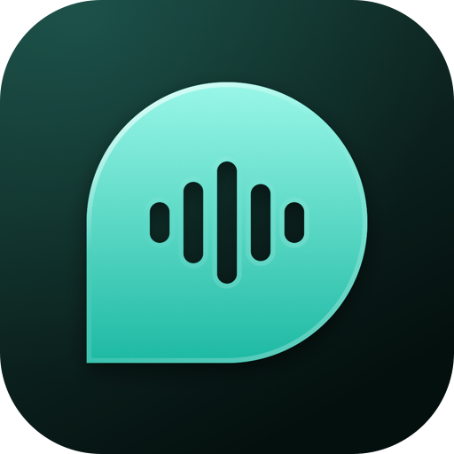
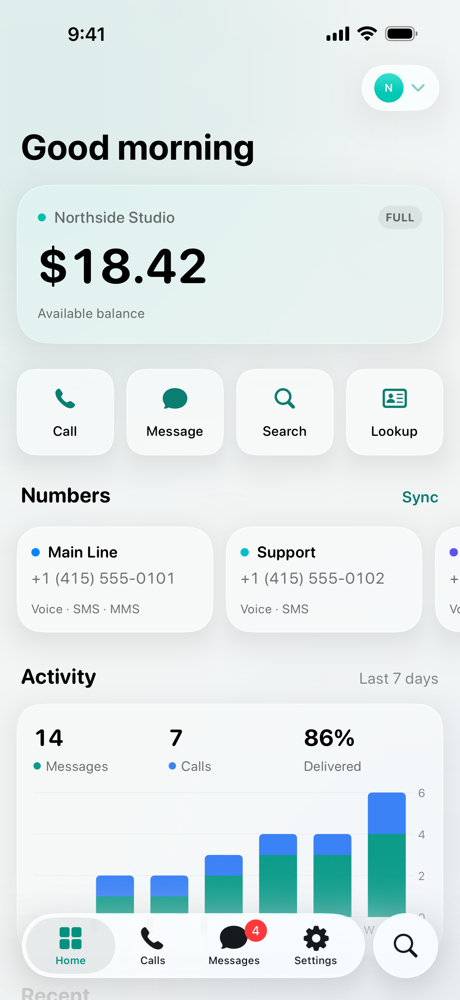
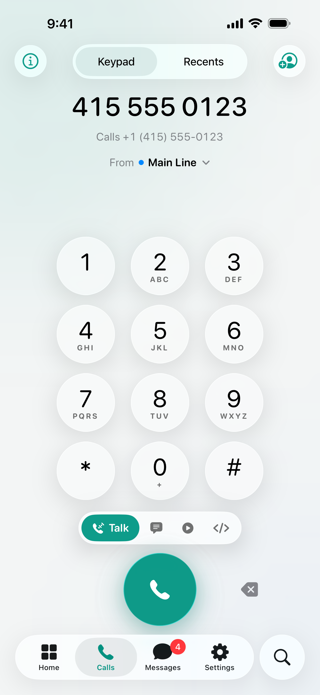
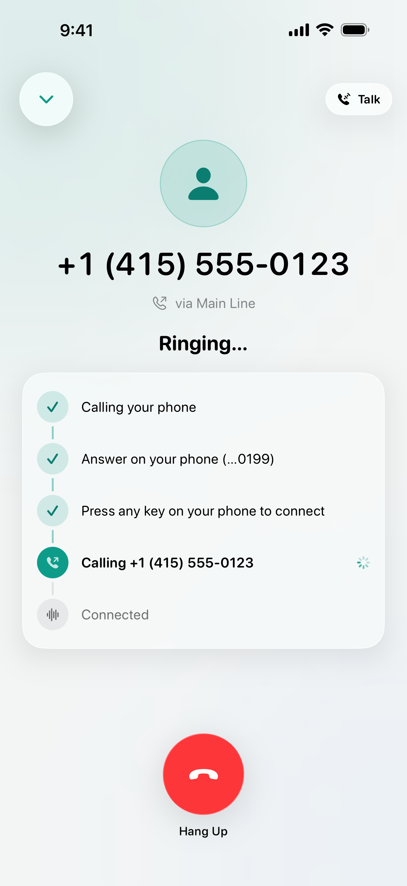
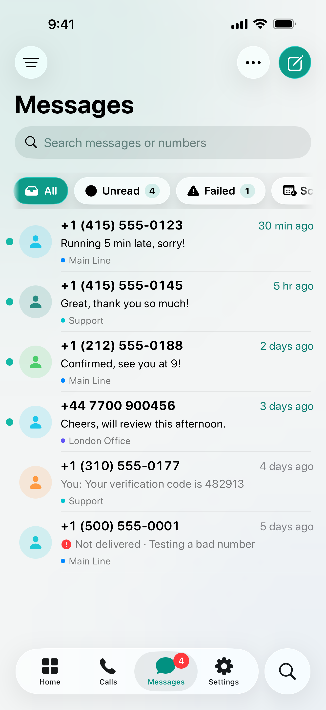
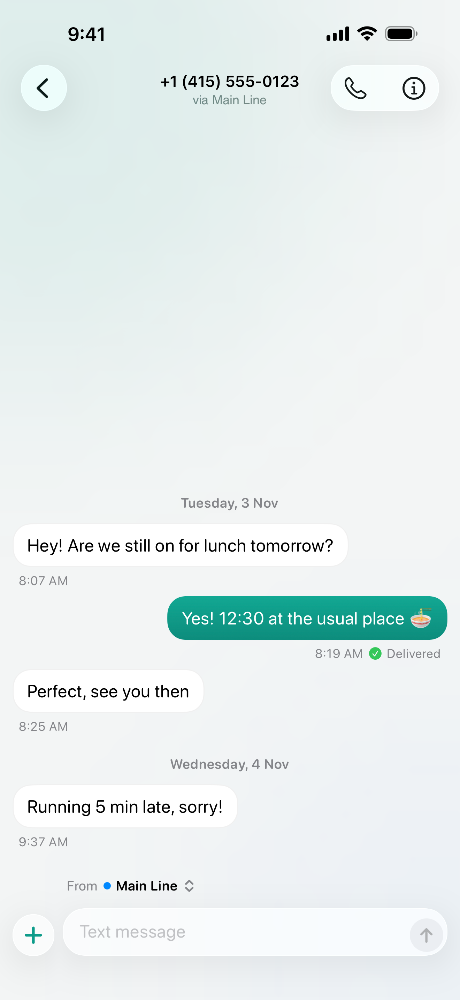

<div align="center">



# Dialbubble

### Your Twilio number, on your iPhone.

Call and text from the Twilio numbers you already own. A free, open-source iPhone app that talks **straight to Twilio**: no server, no subscription, no markup.

[](https://gagndeep.github.io/dialbubble)
[](https://gagndeep.github.io/dialbubble)

[](LICENSE)


[](CONTRIBUTING.md)

[**Website**](https://gagndeep.github.io/dialbubble) · [**Features**](https://gagndeep.github.io/dialbubble/features) · [**How it works**](https://gagndeep.github.io/dialbubble/how-it-works) · [**Privacy**](https://gagndeep.github.io/dialbubble/privacy) · [**Support**](https://gagndeep.github.io/dialbubble/support)

<br>







</div>

---

## Why Dialbubble

Twilio gives you phone numbers, but no phone. Dialbubble is the phone.

- **💸 Free, forever.** No subscription and no markup. You pay Twilio its normal usage rates and nothing else.
- **🔒 No server in the middle.** Your iPhone calls the Twilio REST API directly over TLS. There is no Dialbubble backend, account, analytics or tracking.
- **🔑 Your keys stay on your iPhone.** Credentials live in the iOS Keychain (`AfterFirstUnlockThisDeviceOnly`), and you can read every line that touches them right here.
- **🧪 Try it without signing up.** Tap **Try the Demo** and every screen works on simulated data. Nothing is sent, nothing is charged.
- **⚡ Two-minute guided setup.** Smart Paste finds your Account SID, Auth Token or API Key on the clipboard, then imports your numbers and verified caller IDs.

## Features

| Calling | Texting |
|---|---|
| **Talk**: two-way calls on your regular phone, showing your Twilio number as caller ID | Threaded **SMS and MMS** across all your numbers |
| **Voice Message**: type it, Twilio speaks it (neural voices, loopable) | **Templates**, **scheduled texts** and **broadcast** with per-recipient results |
| **Play Audio** and **Custom TwiML** calls, no webhook server needed | Pins, per-thread drafts, one-tap **sign-in code** copy, tappable links |
| Live call status, hang up, **recording** with playback | Delivery status, segment counter (GSM-7/UCS-2), error explanations |

**Accounts and everyday comforts**

- Multiple Twilio accounts and numbers, with nicknames, colors and default caller IDs
- Balance, usage and cost by category, with a 7-day activity chart
- Twilio Lookup (validation, line type, caller name), global search
- Optional **contact names** (read on-device, never uploaded) and keypad suggestions
- **Works offline**: your latest history is cached on the device, with **CSV export**
- Opt-in **icon badge** and best-effort **alerts while closed** (Background App Refresh)
- **Face ID** app lock, app-switcher privacy screen, Siri and Shortcuts, Home Screen quick actions
- Every Twilio error translated into plain English, with the fix
- Native SwiftUI on iOS 26 with Liquid Glass, Dynamic Type, VoiceOver, light and dark

## How it works

```
 ┌──────────────┐   HTTPS (your credentials)   ┌──────────────┐
 │  Dialbubble  │ ───────────────────────────► │  Twilio API  │
 │  on iPhone   │ ◄─────────────────────────── │ your account │
 └──────────────┘    numbers, texts, calls     └──────────────┘
         ▲                                            │
         └──────── Talk calls ring your phone ────────┘
```

Twilio's Voice SDK needs a token server, so Dialbubble uses the REST API with **inline TwiML** instead:

| Mode | What happens |
|---|---|
| **Talk** | Twilio calls *your* phone first. You press a key, then Twilio dials the other person with your Twilio number as caller ID. You talk on your normal phone. Twilio bills two legs. |
| **Voice Message** | Twilio calls the destination and reads your text aloud. |
| **Play Audio** | Twilio calls and plays an MP3/WAV from a public URL. |
| **Custom TwiML** | Twilio calls and runs any TwiML you write. |

Texts are polled every 20 s while the app is open (every 5 s inside a conversation). With no push server, alerts while closed are best effort: iOS decides when Background App Refresh runs.

## Privacy

Dialbubble collects **nothing**. There is no server to send anything to. Requests go from your iPhone to Twilio under your own account, and Twilio's privacy policy applies to that data. Read the full [privacy policy](https://gagndeep.github.io/dialbubble/privacy).

## Requirements

- iPhone with **iOS 26** or later
- A [Twilio](https://www.twilio.com) account with a phone number or verified caller ID, for real calls and texts (Demo Mode needs nothing)
- Two-way Talk calls, recording and custom texts need a paid (upgraded) Twilio account

## Build from source

```bash
git clone https://github.com/GagnDeep/dialbubble.git
cd dialbubble
brew install xcodegen        # if needed
xcodegen generate
open Dialbubble.xcodeproj    # choose your Team under Signing & Capabilities, then Run
```

Requires Xcode 26 or later. Use launch arguments `-demo` (start in Demo Mode), `-tab home|calls|messages|settings` and `-uiTestReset` (wipe all data) while developing.

**Tests**

```bash
xcodebuild test -project Dialbubble.xcodeproj -scheme Dialbubble \
  -destination 'platform=iOS Simulator,name=iPhone 17 Pro'
```

Unit tests (`DialbubbleTests/`) cover phone formatting, TwiML generation, Twilio JSON decoding, the error guide, offline history, CSV export, contacts search and the demo backend. UI walkthroughs (`DialbubbleUITests/`) tour onboarding, Demo Mode, every tab in light and dark, texting and calling.

## Project structure

```
Dialbubble/
  App/            app entry, root view, status bars
  Core/           Twilio client, AppStore state, Keychain, offline cache, alerts, CSV export
  DesignSystem/   theme tokens, Liquid Glass components, brand mark
  Features/       Calls · Messages · Home · Search · Settings · Onboarding · Help
  Intents/        Siri and Shortcuts (App Intents)
DialbubbleTests/  unit tests
DialbubbleUITests/ UI walkthroughs and App Store screenshot capture
website/          the marketing site (Next.js static export → GitHub Pages)
scripts/          make-icon.swift regenerates the app icon (light, dark, tinted)
docs/DESIGN.md    design tokens and components
```

To regenerate the app icon after changing its geometry: `swift scripts/make-icon.swift`.

## Contributing

Bug reports, ideas and pull requests are welcome. Start with [CONTRIBUTING.md](CONTRIBUTING.md). Found a security issue? Please follow [SECURITY.md](SECURITY.md) and report it privately.

## License

[MIT](LICENSE) © 2026 Gagandeep Singh. The Dialbubble name and icon identify the official app; if you ship your own build, please give it a different name and icon.

---

<sub>Twilio is a trademark of Twilio Inc. Dialbubble is an independent app, not affiliated with or endorsed by Twilio.</sub>
